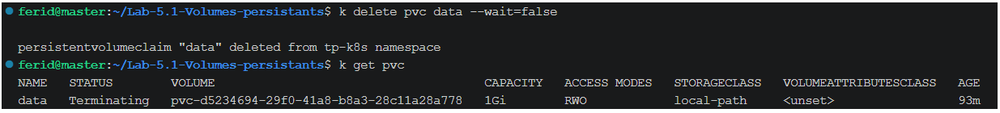
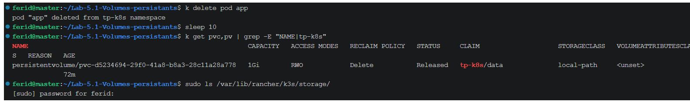
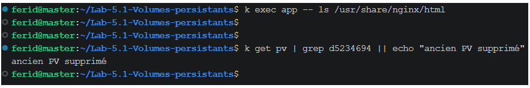
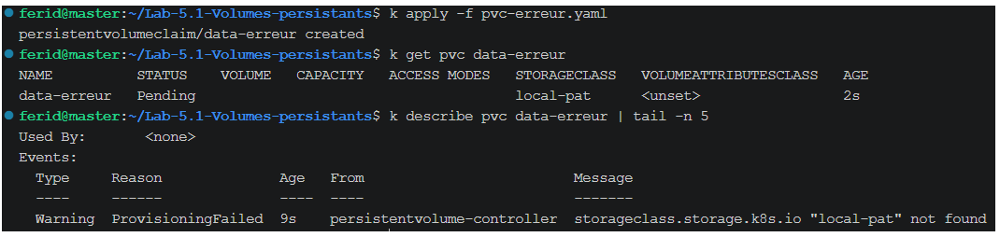
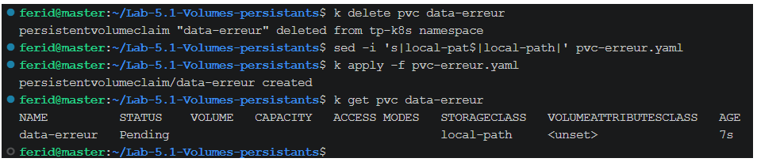

# Lab 5.1 : Volumes persistants

**Auteur :** Ferid Saad
**Formation :** Master DevOps & Cloud, ISET Tozeur
**Cluster :** k3s-vbox (master, worker1, worker2)
**Namespace :** tp-k8s

## Objectifs

- Constater la perte de données d'un conteneur et d'un emptyDir
- Créer un PVC et observer sa liaison avec un PV (provisionnement dynamique)
- Démontrer qu'une donnée survit à la suppression du Pod
- Repérer où les données sont stockées avec local-path
- Observer la suppression d'un PVC et diagnostiquer un PVC bloqué en Pending

## Tableau récapitulatif

| Emplacement | Survit au redémarrage du conteneur | Survit à la suppression du Pod |
|---|---|---|
| Système de fichiers du conteneur | Non | Non |
| emptyDir | Oui | Non |
| PVC | Oui | Oui |
## Étapes

###k exec temp -- sh -c 'echo "dans emptyDir" > /donnees/fichier.txt; echo "dans le conteneur" > /tmp/ephemere.txt'
k exec temp -- ls /donnees /tmp Étape 1 : Namespace et StorageClass
_à compléter_

### Étape 2 : Perte de données avec emptyDir
Pod `temp` (nginx:1.26-alpine) avec un volume `emptyDir` monté sur `/donnees` (fichier `temp.yaml`).

```bash
k apply -f temp.yaml
k wait --for=condition=Ready pod/temp --timeout=60s
k exec temp -- sh -c 'echo "dans emptyDir" > /donnees/fichier.txt; echo "dans le conteneur" > /tmp/ephemere.txt'
k exec temp -- ls /donnees /tmp
```

Avant le redémarrage : `/donnees` contient `fichier.txt` et `/tmp` contient `ephemere.txt`.


Redémarrage du conteneur :

```bash
k exec temp -- nginx -s stop
sleep 10
k get pod temp
k exec temp -- ls /donnees /tmp
```

Résultat : `RESTARTS` passe à 1. `/donnees` contient toujours `fichier.txt`, mais `/tmp` est vide (`ephemere.txt` a disparu).


Suppression puis recréation du Pod :

```bash
k delete pod temp
k apply -f temp.yaml
k wait --for=condition=Ready pod/temp --timeout=120s
k exec temp -- ls /donnees
k delete pod temp
```

Résultat : `/donnees` est vide.

Conclusion :

- Un emptyDir est lié au **Pod** : il survit au redémarrage du conteneur, mais disparaît avec le Pod.
- Le système de fichiers du conteneur est perdu dès que le conteneur redémarre.

Incident : pendant cette étape, le master a été saturé (`soft lockup`, `TLS handshake timeout`), ce qui a retardé les commandes. Après stabilisation, la suppression et la recréation du Pod ont été refaites normalement.

Points de contrôle :

- [x] Après le redémarrage du conteneur, `fichier.txt` existait toujours et `ephemere.txt` avait disparu
- [x] Après la suppression du Pod, `/donnees` était vide

### Étape 3 : Créer un PVC
Création du PVC `data` (1 Gi, `ReadWriteOnce`, StorageClass `local-path`), fichier `pvc.yaml`.

```bash
k apply -f pvc.yaml
k get pvc,pv
k describe pvc data | tail -n 5
```

Résultat :

- Le PVC `data` est `Pending`.
- Aucun PV n'est associé à ce PVC. Les PV visibles dans `k get pv` appartiennent à d'autres namespaces du cluster (`elearning`).
- Les événements de `describe` indiquent que le PVC attend un premier consommateur (`WaitForFirstConsumer`).


Explication : avec `local-path`, le `volumeBindingMode` est `WaitForFirstConsumer`. Le PV n'est créé que lorsqu'un Pod utilise le PVC, ce qui permet de le placer sur le nœud où le Pod sera planifié.

Points de contrôle :

- [x] `k get pvc` affiche `Pending`
- [x] `describe` indique que le PVC attend un premier consommateur (`WaitForFirstConsumer`)


### Étape 4 : Utiliser le PVC dans un Pod
Pod `app` (nginx:1.26-alpine) qui monte le PVC `data` sur `/usr/share/nginx/html` (fichier `app.yaml`).

```bash
k apply -f app.yaml
k get pvc -w
k get pvc,pv
k get pod app -o wide
PV=$(k get pvc data -o jsonpath='{.spec.volumeName}')
k describe pv $PV | grep -E -A6 "Node Affinity|Source"
```

Résultat :

- Le PVC `data` passe de `Pending` à `Bound` dès que le Pod `app` est créé (premier consommateur).
- Un PV `pvc-d5234694-29f0-41a8-b8a3-28c11a28a778` (1Gi, RWO, `local-path`) a été créé automatiquement : c'est le provisionnement dynamique.
- Le Pod s'exécute sur le nœud `master`.
- Le PV porte une affinité vers le nœud `master` (`kubernetes.io/hostname`).


Écriture d'une page web dans le volume et lecture par nginx :

```bash
k exec app -- sh -c 'echo "Bonjour, donnee persistante" > /usr/share/nginx/html/index.html'
k exec app -- wget -qO- http://localhost
```

Résultat : nginx répond `Bonjour, donnee persistante`.


Repérage du dossier sur le nœud qui héberge le Pod :

```bash
sudo ls -R /var/lib/rancher/k3s/storage/
```

Résultat : le dossier `pvc-d5234694-29f0-41a8-b8a3-28c11a28a778_tp-k8s_data` existe et contient `index.html`. Avec `local-path`, les données sont donc stockées directement sur le disque du nœud.


Points de contrôle :

- [x] Le PVC est `Bound` à un PV créé automatiquement
- [x] Le PV porte une affinité vers le nœud du Pod
- [x] La page est servie par nginx, et `index.html` existe dans le dossier du nœud

### Étape 5 : Prouver la persistance
Suppression du Pod `app`, puis recréation avec le même `app.yaml` (le PVC `data` n'est pas touché).

```bash
k delete pod app
k get pvc
k apply -f app.yaml
k wait --for=condition=Ready pod/app --timeout=120s
k get pod app -o wide
k exec app -- wget -qO- http://localhost
```

Résultat :

- Pendant que le Pod n'existe plus, le PVC `data` reste `Bound` : le PVC et le PV vivent indépendamment du Pod.
- Le nouveau Pod affiche `Bonjour, donnee persistante` : la donnée a survécu à la suppression du Pod.
- Le nouveau Pod s'exécute sur le nœud `master`, le même que le précédent. L'affinité du PV `local-path` vers ce nœud impose ce placement.


Conclusion : contrairement à l'emptyDir (étape 2), les données d'un PVC survivent à la suppression du Pod.

Points de contrôle :

- [x] Le PVC est resté `Bound` pendant que le Pod n'existait plus
- [x] Le nouveau Pod affiche le même message
- [x] Il s'exécute sur le même nœud que le Pod précédent

### Étape 6 : Supprimer le PVC
Suppression du PVC `data` alors que le Pod l'utilise encore, puis suppression du Pod.

```bash
k delete pvc data --wait=false
k get pvc
k delete pod app
sleep 10
k get pvc,pv
sudo ls /var/lib/rancher/k3s/storage/
```

Résultat :

- Le PVC reste `Terminating` tant que le Pod `app` existe : c'est une protection (`pvc-protection`) qui empêche de supprimer un volume en cours d'utilisation.
- Après la suppression du Pod, le PVC disparaît. Le PV passe brièvement à l'état `Released`, puis est supprimé automatiquement (rétention `Delete`).
- Sur le nœud, le dossier `pvc-..._tp-k8s_data` n'existe plus dans `/var/lib/rancher/k3s/storage/` : les données ont été effacées.





Recréation du PVC et du Pod :

```bash
k apply -f pvc.yaml
k apply -f app.yaml
k wait --for=condition=Ready pod/app --timeout=120s
k exec app -- ls /usr/share/nginx/html
```

Résultat : le dossier est vide. Le nouveau PVC est lié à un nouveau PV, et la page `index.html` de l'étape 4 est perdue.



Conclusion : avec une rétention `Delete`, supprimer le PVC supprime aussi le PV et les données. La persistance protège des suppressions de Pod, pas de la suppression du PVC.

Points de contrôle :

- [x] Le PVC est resté `Terminating` tant que le Pod existait
- [x] Après suppression, ni PVC ni PV (ancien) ne subsistaient
- [x] Le volume recréé est vide : la page précédente a été perdue

### Étape 7 : Diagnostiquer un PVC en Pending
Création volontaire d'un PVC avec une StorageClass qui n'existe pas (`local-pat` au lieu de `local-path`), fichier `pvc-erreur.yaml`.

```bash
k apply -f pvc-erreur.yaml
k get pvc data-erreur
k describe pvc data-erreur | tail -n 5
```

Résultat :

- Le PVC `data-erreur` reste `Pending`.
- La section `Events` de `describe` indique que la StorageClass `local-pat` est introuvable : c'est la cause du blocage.



Le champ `storageClassName` d'un PVC n'est plus modifiable après sa création. La correction consiste à supprimer le PVC, corriger le fichier, puis le recréer :

```bash
k delete pvc data-erreur
sed -i 's|local-pat$|local-path|' pvc-erreur.yaml
k apply -f pvc-erreur.yaml
k get pvc data-erreur
```

Résultat : le PVC est recréé avec `local-path`. Il reste `Pending`, mais sans erreur : il attend un premier Pod (`WaitForFirstConsumer`).



Méthode de diagnostic d'un PVC en `Pending` :

1. `k get pvc` pour confirmer l'état.
2. `k describe pvc` et lire `Events`.
3. Vérifier `k get storageclass` (nom exact de la classe).
4. Si le PVC est correct et sans erreur, vérifier qu'un Pod l'utilise.

Points de contrôle :

- [x] La StorageClass introuvable a été lue dans les événements
- [x] Après correction, le PVC n'affiche plus d'erreur (il attend un Pod)

## Réponses aux questions de réflexion
1. **Pourquoi le fichier de l'emptyDir a-t-il survécu au redémarrage du conteneur mais pas à la suppression du Pod ?**
   Un emptyDir appartient au Pod, pas au conteneur. Quand le conteneur redémarre, le Pod existe toujours et son volume est conservé. Quand le Pod est supprimé, son emptyDir est supprimé avec lui.

2. **Pourquoi le Pod recréé a-t-il été placé sur le même nœud ?**
   Le PV créé par `local-path` porte une affinité vers le nœud où se trouvent les données (`master`). Le scheduler doit donc placer tout Pod qui utilise ce PVC sur ce nœud.

3. **Que se passerait-il pour l'application si le nœud hébergeant le volume tombait en panne ?**
   Les données sont sur le disque de ce seul nœud, sans réplication. Le Pod ne pourrait pas être replanifié ailleurs et resterait indisponible (`Pending`) jusqu'au retour du nœud. Si le disque était perdu, les données le seraient aussi. Pour la haute disponibilité, il faut un stockage répliqué (par exemple Longhorn).

4. **Pourquoi le PVC est-il resté en Terminating tant que le Pod existait ?**
   Un finalizer de protection (`kubernetes.io/pvc-protection`) empêche de supprimer un PVC utilisé par un Pod. La suppression n'aboutit qu'une fois le Pod supprimé, ce qui évite de retirer son stockage à une application en cours d'exécution.

5. **Quelle précaution prendre avant de supprimer un PVC dont la rétention est Delete ?**
   La suppression du PVC entraîne celle du PV et des données. Il faut donc sauvegarder ce qui doit être conservé, vérifier la `reclaimPolicy` et, si besoin, passer le PV en `Retain` avant la suppression.

## Nettoyage
_à compléter_
